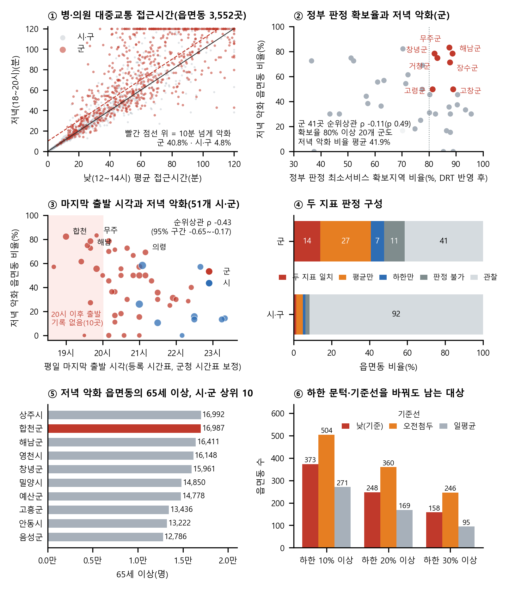

# 몇 번이 아니라 몇 시까지

국가승인통계로 농어촌 저녁 대중교통 공백을 찾는 판정표의 분석 코드입니다.
「AI와 함께하는 교통문제 해결을 위한 데이터 분석 공모전」(재단법인 숲과나눔 × 한겨레, 2026) 출품작이며 팀 다봄이 만들었습니다.

## 무엇을 하나

정부의 대중교통 최소서비스 판정은 정류장까지 거리와 하루 운행횟수로 정합니다. 몇 시까지 다니는지는 판정에 들어가지 않습니다.

이 코드는 한국교통연구원 교통접근성지표 2025의 낮(12~14시) 값과 저녁(18~20시) 값을 전국 읍면동 3,552곳에 같은 규칙으로 적용하고, 두 지표로 저녁 공백을 판정합니다.

- **평균 악화**: 병·의원까지 대중교통 평균 접근시간이 저녁에 10분 넘게 늘어나는가
- **연결 상실 하한**: "낮엔 대중교통 60분 안, 저녁엔 60분 밖, 승용차로는 30분 안"인 주민이 적어도 몇 %인가. 개인 기록 없이 집계표만으로 구합니다.

## 주요 결과

| 결과 | 값 | 스크립트 → 출력 |
|---|---|---|
| 저녁 악화 읍면동 | 군 335/822곳(40.8%), 시·구 131/2,730곳(4.8%) | `06` → `읍면동_최종판정.csv` |
| 악화 문턱 5~30분 | 군 50.2~19.8%, 시·구 6.8~1.6% | `26` → `문턱민감도.json` |
| 정부 판정 확보율과 저녁 악화(군 41곳) | 순위상관 ρ = -0.11(p = 0.49). DRT 반영 전에는 -0.36(p = 0.02), 두 값 차이의 95% 구간 0.11~0.38 | `25` → `공식판정_비교.json` |
| 막차 시각과 저녁 악화(51개 시·군) | ρ = -0.43(95% 구간 -0.65~-0.17). 목적지 시설을 바꾸면 -0.38~-0.56 | `07` → `보고서_추가지표.json`, `27` → `시설별_막차상관.json` |
| 120분 상한을 뺀 비교 | 20시 이후 출발 기록이 없는 10곳 64.7%, 그 밖의 군 33.0% | `28` → `상한제외_비교.json` |
| 두 지표 일치 읍면동 | 151곳, 주민 40.2만 명 | `06` → `최종지표.json` |



① 읍면동별 낮·저녁 병·의원 접근시간 ② 정부 판정 확보율과 저녁 악화 ③ 마지막 출발 시각과 저녁 악화 ④ 두 지표 판정 구성 ⑤ 저녁 악화 읍면동의 65세 이상 상위 10개 시·군 ⑥ 하한 문턱·기준선 민감도

## 폴더 구조

```
evening-transit-gap/
├── README.md
├── requirements.txt
├── docs/results.png   README 그림
└── scripts/           분석 코드 01~28
```

원자료는 `데이터/원천_PC다운로드/`에 둡니다. 실행하면 가공 자료가 `데이터/가공/`에, 그림이 `fig/`에 생깁니다. 두 폴더는 저장소에 올리지 않습니다.

## 실행

Python 3.13에서 확인했습니다.

```
pip install -r requirements.txt
```

경로는 저장소 루트를 기준으로 잡습니다. 24~28번은 첫 인자로 다른 루트 폴더를 받을 수 있습니다.

| 순서 | 스크립트 | 하는 일 |
|---|---|---|
| 1 | `15` `16` `17` | 원자료 내려받기(네트워크 필요, 이미 받았다면 건너뜀) |
| 2 | `01` | 노선 시간표에서 지자체별 마지막 출발 시각 계산 |
| 3 | `02` | 교통접근성지표에서 읍면동·시설별 낮·저녁 값 추출(120분 상한 표시 보존) |
| 4 | `03` → `04` → `05` | 평균 악화 유형(A~E)과 인구·경계 결합, 연결 상실 하한(기준선 3종), 상한 판정 불가 구분 |
| 5 | `06` | 두 지표 최종 판정, 시·군 순위, 합천군 시범 비용, 보고서 그림 2·3 |
| 6 | `07` `08` | 승용차 대비 배율, 막차 시각과 저녁 악화 상관, 판정별 13~18세 인구 |
| 7 | `09` → `10` → `11` | 자치법규 수집(`09`는 인수 probe → list → filter → body 순), 대상·조건 추출, 운행시각 조항 추출 |
| 8 | `25` | 2025 대중교통 현황조사 표 3-24(정부 판정)와 비교 |
| 9 | `24` | 보고서 그림 1·4 |
| 10 | `12` `13` `14` `26` `27` `28` | 검증: 하한식 재구현, 기준선 민감도, 인구 환산, 악화 문턱, 시설별 상관, 상한 제외 비교 |
| 참고 | `18` `19` `20`, `21`~`23` | 군청 시간표 수집·대조, HWP 시간표 추출, 시외·고속버스 API 확인 |

21~23번은 공공데이터포털 인증키를 `데이터/.env`의 `DATA_GO_KR_KEY`에서 읽습니다. 인증키는 저장소에 올리지 않습니다.

## 원자료

원자료는 제공처 이용조건에 따라 재배포하지 않습니다. 아래에서 받아 `데이터/원천_PC다운로드/`에 둡니다.

| 자료 | 제공 | 받는 곳 | 기준 |
|---|---|---|---|
| 교통접근성지표 2025(평균접근시간·접근가능 인구비율) | 한국교통연구원 | https://www.ktdb.go.kr/www/selectBbsNttView.do?key=45&bbsNo=2&nttNo=3829 | 2025(2026.9.30 공표) |
| 교통접근성지표 2023 | 한국교통연구원 | KOSIS | 2023 |
| 버스 노선 및 시간표 정보 | 한국교통안전공단 | https://www.data.go.kr/data/15150451/fileData.do | 2026.7 |
| BIS 버스노선정보 | 한국교통안전공단 | https://www.data.go.kr/data/15105964/fileData.do | 2026.7 |
| 행정동별 성별·연령별 주민등록인구 | 행정안전부 | https://www.data.go.kr/data/15097972/fileData.do | 2026.9.30 |
| 행정동 경계 | vuski/admdongkor(CC BY 4.0) | https://github.com/vuski/admdongkor | 2026.10.1 |
| 2025 대중교통 현황조사 보고서 | 국토교통부·한국교통안전공단 | https://www.kotsa.or.kr/ptc/ptcData.do (`대중교통현황조사_PTC/`에 저장) | 2025 |
| 자치법규 본문 | 행정안전부 자치법규정보시스템 | https://www.elis.go.kr | 2026.10.22 열람 |
| 군청 공식 버스 시간표(11개 군) | 각 군청 | `18`번 스크립트의 주소 목록 | 2026.8~10 |

## 정의

- **저녁 악화(유형 A·B·C)**: 병·의원 평균 접근시간이 저녁에 낮보다 10분 넘게 늘어난 읍면동입니다. 저녁만 120분 상한이면 `120 - 낮 값`이 10분 이상일 때 악화로 봅니다. 그보다 작거나 낮·저녁 모두 상한이면 '판정 불가'로 둡니다.
- **연결 상실 하한**: `max(0, D + C - E - 100 - 0.015)`입니다. D는 낮 대중교통 60분, E는 저녁 대중교통 60분, C는 저녁 승용차 30분 안에 닿는 인구 비율(%)입니다. 세 사건의 프레셰 하한(Fréchet 1935)이며, 0.015%p는 공표값 반올림 오차를 감안해 보수적으로 뺀 값입니다. 병·의원과 버스터미널 중 큰 값을 씁니다.
- **두 지표 일치**: 저녁 악화이면서 하한이 20% 이상인 읍면동입니다.
- 문턱(10분·20%·60분)은 법정 기준이 아니라 분석자가 정한 값입니다. 문턱을 바꾼 결과는 `12` `13` `26` 출력에 있습니다.

## 재현 범위

- 분석보고서 검증표 가운데 '시간표 정의 5종'과 '2023년판' 행은 교차검증 단계에서 따로 계산했고, 이 저장소에는 넣지 않았습니다.
- 원자료가 다시 공표되거나 수정되면 소수점 아래 값이 달라질 수 있습니다.
- 개인 단위 이동기록은 쓰지 않았습니다. 모든 입력은 공개 집계자료입니다.

## AI 활용

분석 코드 작성과 정리, 군청 시간표·자치법규 추출, 계산 교차검증에 Claude(Anthropic)와 GPT(OpenAI Codex CLI)를 썼습니다. 분석보고서의 수치는 위 두 행을 빼고 이 저장소 스크립트 출력과 대조했습니다.
